> This post is adapted from JavaGuide's "[Summary of common operating system interview questions (part 1)](https://javaguide.cn/cs-basics/operating-system/operating-system-basic-questions-01.html)" (Apache-2.0 license) and rewritten in English. Unless noted otherwise, the images come from that article, and their labels are in Chinese. Parts of the original draw on *Modern Operating Systems*, 3rd edition.

Operating system concepts are numerous and scattered, but they show up everywhere in day-to-day development. This post covers the more important ones: user mode and kernel mode, system calls, processes and threads, and deadlocks. It's an overview; for depth, a textbook is still the way to go.

Why learn operating systems? Many of their ideas and classic algorithms reappear in the tools and frameworks we use every day. A cache like Redis, for example, is a lot like the CPU cache. The CPU cache bridges the speed gap between the CPU and memory. Memory can itself be seen as a cache for external storage: when a program runs, data is copied from disk into much faster memory. Redis bridges the speed gap between an application and a relational database. Caches usually follow the principle of locality (the 80/20 rule) and use an eviction algorithm to keep frequently accessed data in the cache, and many of those algorithms resemble ones from operating systems. The metric common to every cache is the hit rate: how much of the data you need can be found directly in the cache. A high hit rate usually means the cache is well designed and the system is relatively fast. Operating systems are also a very common interview topic, especially for new-graduate hiring.

## Operating system basics


### What is an operating system

1. An operating system (OS) is the program that manages a computer's hardware and software resources. It is the foundation of the computer.
2. At heart, the OS is a software program running on the computer. Every application on your computer uses memory, disks, and other hardware through the OS.
3. The OS hides the complexity of the hardware layer. Think of it as the hardware's manager, coordinating everything related to it.
4. The kernel is the core of the OS. It handles memory management, hardware device management, file system management, and application management. The kernel is the bridge between applications and hardware and determines the system's performance and stability.

People often confuse the kernel with the CPU (Central Processing Unit). Two points tell them apart:

1. The kernel belongs to the operating system; the CPU is hardware.
2. The CPU provides computation and executes instructions. The kernel handles system management (such as memory management) and hides direct hardware operations.

The diagram below shows how applications, the kernel, and the CPU relate:

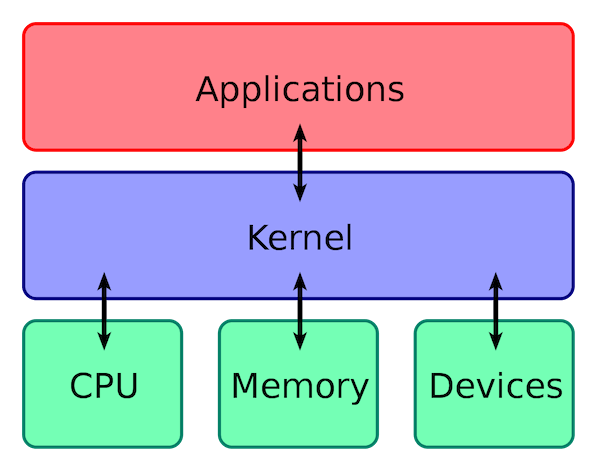

Image: [Kernel_Layout.svg](https://commons.wikimedia.org/wiki/File:Kernel_Layout.svg) by Bobbo, Wikimedia Commons, licensed under [CC BY-SA 3.0](https://creativecommons.org/licenses/by-sa/3.0/).

### Main functions of an operating system

From a resource-management point of view, an OS has six main functions:

1. **Process and thread management**: creating, terminating, blocking, and waking processes; inter-process communication; and so on.
2. **Storage management**: allocating and managing memory and external storage (disks, etc.).
3. **File management**: reading, writing, creating, and deleting files.
4. **Device management**: requesting, releasing, and starting I/O devices and external storage devices.
5. **Network management**: managing network configuration, connections, communication, and security to provide efficient, reliable network services.
6. **Security management**: user authentication, access control, file encryption, and so on, to keep unauthorized users from accessing or manipulating system resources.

### Common operating systems

- **Windows**: currently the most popular desktop OS. It's easy to use, has an excellent software ecosystem, and is basically required for gaming.
- **Unix**: the earliest multi-user, multitasking OS. Linux borrowed from it in many ways. It has gradually faded from the mainstream.
- **Linux**: a free, open-source Unix-like OS. There are many distributions, but they all use the Linux kernel.
- **macOS**: Apple's own OS. The development experience is on par with Linux, while the interface, software ecosystem, and user experience are better.

> Strictly speaking, the word Linux refers only to the Linux kernel. In a GNU/Linux system, Linux is the kernel, and most of the rest of the system consists of programs from the GNU Project. The Linux kernel alone is not a complete, working operating system, which is why many people prefer the term "GNU/Linux" for what is usually called Linux.

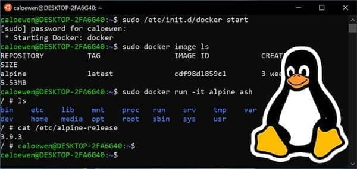

## User mode and kernel mode

### What are user mode and kernel mode

Based on how processes access resources, execution on a system can be split into two levels:

- **User mode**: can directly read user program data and has low privileges. When an application needs a privileged operation (such as reading or writing a disk or network communication), it makes a system call to the OS and enters kernel mode.
- **Kernel mode**: can access almost every resource on the computer, including system memory, devices, and drivers, with very high privileges. When the OS receives a system call from a process, it switches from user mode to kernel mode, executes the system call, returns the result to the process, and then switches back to user mode.

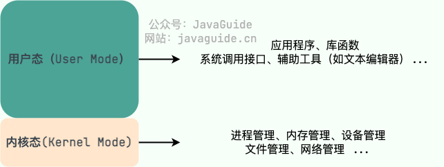

Kernel mode has a higher privilege level, so it can perform lower-level, more sensitive operations. But entering kernel mode is costly (a series of context switches and permission checks), so you should enter it as rarely as possible for better performance and stability.

### Why not have kernel mode only

- Some CPU instructions are dangerous, such as memory allocation, setting the clock, and I/O handling. If every program could use them, the results could be catastrophic, so these instructions are restricted to kernel mode. They are called **privileged instructions**.
- With only kernel mode, every program would share memory, CPU, disks, and other resources directly, causing contention and conflicts that hurt performance. Every program would also have the same privileges, which lowers security.

So having both user mode and kernel mode is mainly about the system's security, stability, and performance.

### How the switch happens

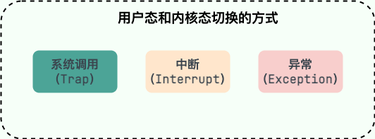

There are three ways to switch from user mode to kernel mode:

1. **System call (trap)**: a user-mode process **actively** asks to switch to kernel mode in order to do something only kernel mode can, such as reading from disk. Under the hood, the system call mechanism is an interrupt the OS specifically exposes to users.
2. **Interrupt**: when a peripheral device finishes an operation the user requested, it sends an interrupt signal to the CPU. The CPU pauses the next instruction it was about to run and executes the corresponding interrupt handler instead. If the code that was running was in user mode, this naturally causes a switch from user mode to kernel mode. For example, when a disk read or write completes, the system switches to the disk I/O interrupt handler.
3. **Exception**: while running a user-mode program, the CPU hits an unexpected exception and switches to the kernel code that handles it, entering kernel mode. A page fault is an example.

In terms of handling, interrupts and exceptions are similar: both use the interrupt vector table to find the right handler. The difference is that an interrupt comes from outside the processor and isn't caused by any particular instruction, while an exception is the result of executing the current instruction.

## System calls

### What is a system call

The programs we run almost always run in user mode. To use kernel-level functionality provided by the OS, you need a system call. In other words, any operation involving system-level resources (file management, process control, memory management, and so on) must go through a system call: the program requests the service, and the OS performs it.

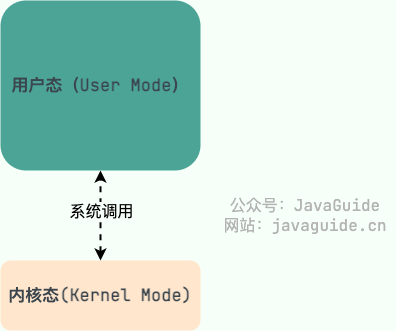

System calls fall roughly into these categories:

- **Device management**: requesting, releasing, and starting devices.
- **File management**: reading, writing, creating, and deleting files.
- **Process management**: creating, terminating, blocking, and waking processes; inter-process communication.
- **Memory management**: allocating and freeing memory, and getting the size and address of the memory a job occupies.

A system call looks a lot like an ordinary library call. The difference is that system calls are provided by the OS kernel and run in kernel mode, while library calls are provided by a library or by the user and run in user mode.

In short, system calls are how applications interact with the operating system; through them, applications access low-level resources like files, devices, and the network.

### What happens during a system call

1. A user-mode program makes a system call. Because the call involves privileged instructions and the user-mode program lacks the privileges, execution is interrupted. This is a trap (a kind of interrupt).
2. After the interrupt, the CPU stops the current program and jumps to the interrupt handler, and kernel code starts handling the system call.
3. When the kernel is done, it triggers a trap again, causing another interrupt that switches back to user mode.

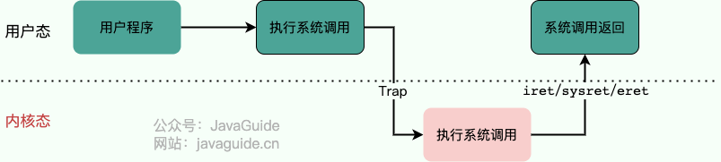

## Processes and threads

### What are processes and threads

- **Process**: an instance of a program currently running on the computer. The messaging app you open, for example, is a process.
- **Thread**: also called a lightweight process. Multiple threads can run within the same process at once and share its resources, such as memory space, file handles, and network connections. The messaging app, for example, has a thread dedicated to fetching new messages.

### How processes and threads differ

Let's look at the relationship from the JVM's point of view. The diagram below shows Java's memory areas:

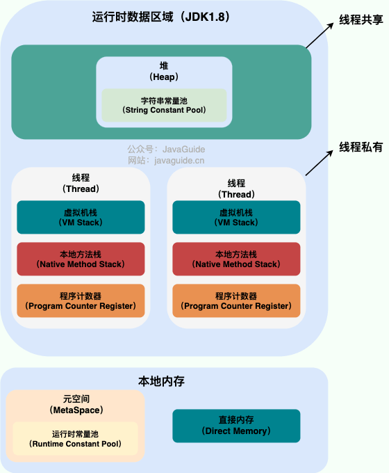

A process can contain multiple threads. They share the process's **heap** and **method area** (metaspace since JDK 1.8), but each thread has its own **program counter**, **VM stack**, and **native method stack**.

In summary:

- A thread is a smaller unit of execution carved out of a process; a process can spawn multiple threads as it runs.
- The biggest difference is that processes are basically independent of each other, while threads are not necessarily: threads in the same process can easily affect one another.
- Threads are cheap to run but harder to manage and protect; processes are the opposite.

### Why have threads when we have processes

- Switching processes is expensive; switching threads is cheaper.
- Threads are lighter, and one process can create many of them.
- Multiple threads can handle different tasks concurrently, making better use of multiprocessor and multicore machines. A process can only do one thing at a time; if it blocks, for example on I/O, it is suspended until the result comes back.
- Threads in the same process share memory and files, so they can communicate without calling into the kernel.

### Why use multithreading

At a high level:

- **From the hardware's perspective**: a thread is the smallest unit of program execution, and switching and scheduling threads costs far less than processes. Multicore CPUs also let multiple threads run simultaneously, reducing thread context-switching overhead.
- **From the industry's perspective**: today's systems routinely need to handle millions or tens of millions of concurrent requests. Multithreaded concurrent programming is the foundation of high-concurrency systems, and using it well greatly improves a system's concurrency and performance.

Digging deeper:

- **Single-core era**: multithreading was mainly about making a single process use the CPU and I/O more efficiently. Suppose there is one Java process with only one thread. When that thread blocks on I/O, the whole process blocks, and only one of the CPU or the I/O device is working at a time, so you could roughly say the system runs at 50% efficiency. With multiple threads, when one blocks on I/O, the others can keep using the CPU.
- **Multicore era**: multithreading is mainly about letting a process use multiple CPU cores. If you compute a complex task with one thread, only one core is used no matter how many the system has. With multiple threads mapped onto multiple cores, and no resource contention between them, execution time drops to roughly "single-core time ÷ number of cores".

### Thread synchronization methods

Thread synchronization keeps two or more threads that share critical resources from conflicting while running concurrently. Common methods:

1. **Mutex**: only the thread holding the mutex object can access the shared resource. Since there is only one mutex, the resource can't be accessed by multiple threads at once. Java's `synchronized` keyword and the various `Lock` implementations work this way.
2. **Read-write lock**: lets multiple threads read a shared resource at the same time, but only one thread can write to it.
3. **Semaphore**: lets multiple threads access the same resource at once, but caps how many can do so simultaneously.
4. **Barrier**: a synchronization primitive that makes multiple threads wait at a certain point until all of them arrive, then continue together. Java's `CyclicBarrier` works this way.
5. **Event**: wait/notify. Threads stay synchronized through notifications, which also makes it easy to compare thread priorities.

### What is a PCB

A **PCB (Process Control Block)** is the data structure the OS uses to manage and track a process. Every process has its own PCB; think of it as the process's brain.

When the OS creates a process, it assigns a unique process ID and creates a matching PCB. The PCB's contents change constantly as the process runs, and the OS uses them to manage and schedule the process. A PCB mainly contains:

- Descriptive information: the process name, identifier, and so on.
- Scheduling information: why the process is blocked, its state (ready, running, blocked, etc.), its priority, and so on.
- Resource requirements: CPU time, memory space, I/O devices, and so on.
- Open files: file descriptors, file types, open modes, and so on.
- Processor state (the contents of the registers): general-purpose registers, the instruction counter, the program status word (PSW), and the user stack pointer.
- And more.

### Process states

Processes are generally described as having five states, much like threads:

- **New**: the process is being created and isn't ready yet.
- **Ready**: the process has every resource it needs except the processor and will run as soon as it gets a time slice.
- **Running**: the process is executing on a processor (on a single-core CPU, only one process is running at any moment).
- **Waiting (blocked)**: the process is paused waiting for an event, such as a resource becoming available or I/O completing. It can't run even if the processor is idle.
- **Terminated**: the process is being removed from the system, either because it finished normally or because it was interrupted for some other reason.

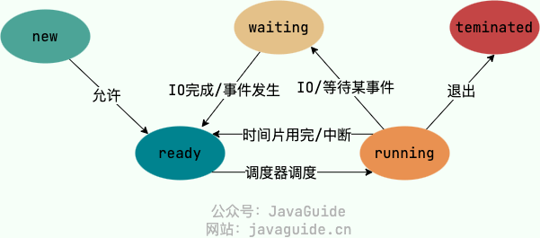

### Inter-process communication

1. **Pipes (anonymous pipes)**: for communication between related processes, such as parent and child or siblings.
2. **Named pipes**: anonymous pipes have no name, so they only work between related processes. Named pipes overcome that limit. They strictly follow **first in, first out (FIFO)** and exist as files on disk, so any two processes on the same machine can use them.
3. **Signals**: a relatively complex mechanism used to notify the receiving process that some event has occurred.
4. **Message queues**: a linked list of messages with a specific format, stored in memory and identified by a message queue identifier. Pipes and message queues both deliver data first in, first out. The difference is that anonymous pipes exist only in memory and named pipes exist on disk or in the file system, while message queues live in the kernel and are only truly deleted when the kernel restarts (the OS reboots) or the queue is explicitly deleted. Message queues also support random lookup: messages don't have to be read in FIFO order and can be read by type, which makes them more flexible than FIFO. **Message queues overcome the drawbacks that signals carry little information and that pipes carry only unformatted byte streams with limited buffer sizes.**
5. **Semaphores**: a counter used when multiple processes access shared data. Its purpose is inter-process synchronization, mainly to solve synchronization problems and avoid race conditions.
6. **Shared memory**: lets multiple processes access the same block of memory, so updates by one process are immediately visible to the others. It needs a synchronization mechanism such as a mutex or semaphore. It's arguably the most useful form of IPC.
7. **Sockets**: mainly for client-server communication over a network. A socket is the basic unit of TCP/IP network communication and can be seen as the endpoint for two-way communication between processes on different hosts.

### Process scheduling algorithms

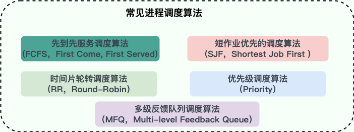

To decide which process runs first and which runs last, and so maximize CPU utilization, computer scientists defined several algorithms:

- **First Come, First Served (FCFS)**: picks the process that entered the ready queue first and lets it run until it finishes, or until some event blocks it and it gives up the CPU, then schedules again.
- **Shortest Job First (SJF)**: picks the process in the ready queue with the shortest estimated run time and likewise runs it until it finishes or blocks.
- **Round-Robin (RR)**: the oldest, simplest, fairest, and most widely used algorithm. Each process is given a slice of time it is allowed to run, called a time slice.
- **Multi-level Feedback Queue (MFQ)**: the previous algorithms all have limits; for example, **SJF favors short processes and neglects long ones**. MFQ lets high-priority jobs get a quick response while short jobs finish fast, and is **widely regarded as one of the better scheduling algorithms**. UNIX uses it.
- **Priority scheduling**: each process gets a priority, and the highest-priority process runs first, and so on; processes with the same priority run FCFS. Priority can be based on memory requirements, time requirements, or any other resource requirement.

### Zombie and orphan processes

On Unix/Linux, a child process is usually created with the `fork()` system call, which makes a copy of the original process. Parent and child run independently, each with its own PCB, and the child can keep running even after the parent exits.

When a process ends by calling `exit()`, the kernel frees all its resources (open files, memory, and so on), but its PCB stays in the system until the parent calls `wait()` or `waitpid()`, so the parent can get the child's exit status.

- **Zombie process**: the child has terminated, but the parent is still running and hasn't called `wait()` or `waitpid()` to collect the child's status and free its resources, so the child's PCB stays in the system. To avoid zombies, the parent must call `wait()` or `waitpid()` promptly to reap its children.
- **Orphan process**: the parent has terminated or no longer exists, but the child is still running. This usually happens when the parent terminates unexpectedly. To keep orphans from tying up resources, the OS sets their parent to the init process (PID 1), which reaps them.

### Checking for zombie processes

On Linux you can use `top`: the `zombie` value is the number of zombie processes, and 0 means there are none.

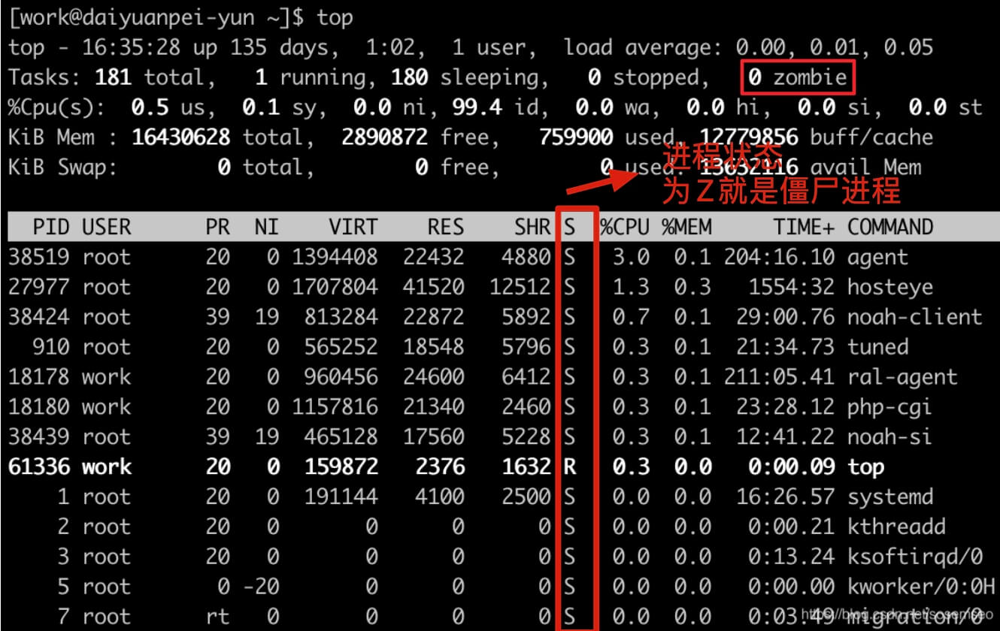

This command finds zombie processes and their parents:

```bash
ps -A -ostat,ppid,pid,cmd | grep -e '^[Zz]'
```

## Deadlock

### What is a deadlock

A deadlock happens when multiple processes or threads are blocked at the same time, with one or all of them waiting for a resource to be released. Because they are blocked indefinitely, the program can never terminate normally.

### A deadlock example

Suppose there are processes A and B and resources X and Y:

| Process | Holds | Needs |
| --- | --- | --- |
| A | X | Y |
| B | Y | X |

A holds X and requests Y, while B holds Y and requests X. Each waits for the other to release a resource, neither can proceed, and they are deadlocked.

### The four necessary conditions for deadlock

1. **Mutual exclusion**: a resource is non-shareable, so only one process can use it at a time. Any other process requesting it must wait until it is released.
2. **Hold and wait**: a process holds at least one resource while waiting for another resource held by a different process.
3. **No preemption**: resources can't be taken away; a resource is released only after the process holding it finishes its task.
4. **Circular wait**: there is a set of waiting processes `{P0, P1, ..., Pn}` where `P0` waits for a resource held by `P1`, `P1` waits for one held by `P2`, ..., and `Pn` waits for one held by `P0`.

**Note**: these four are **necessary conditions**. Whenever a deadlock occurs, all four hold; if any one of them doesn't hold, a deadlock can't occur.

> Definition of a necessary condition: if without A there can be no B (that is, whenever B holds, A holds), then A is a necessary condition for B. Logically, B implies A; A being necessary for B is equivalent to B being sufficient for A.

### Code that simulates a deadlock

The Java code below simulates the thread deadlock shown in the diagram:

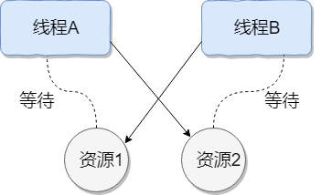

```java
public class DeadLockDemo {
    private static Object resource1 = new Object();//resource 1
    private static Object resource2 = new Object();//resource 2

    public static void main(String[] args) {
        new Thread(() -> {
            synchronized (resource1) {
                System.out.println(Thread.currentThread() + "get resource1");
                try {
                    Thread.sleep(1000);
                } catch (InterruptedException e) {
                    e.printStackTrace();
                }
                System.out.println(Thread.currentThread() + "waiting get resource2");
                synchronized (resource2) {
                    System.out.println(Thread.currentThread() + "get resource2");
                }
            }
        }, "Thread 1").start();

        new Thread(() -> {
            synchronized (resource2) {
                System.out.println(Thread.currentThread() + "get resource2");
                try {
                    Thread.sleep(1000);
                } catch (InterruptedException e) {
                    e.printStackTrace();
                }
                System.out.println(Thread.currentThread() + "waiting get resource1");
                synchronized (resource1) {
                    System.out.println(Thread.currentThread() + "get resource1");
                }
            }
        }, "Thread 2").start();
    }
}
```

Output:

```
Thread[Thread 1,5,main]get resource1
Thread[Thread 2,5,main]get resource2
Thread[Thread 1,5,main]waiting get resource2
Thread[Thread 2,5,main]waiting get resource1
```

Thread 1 acquires the monitor lock on `resource1` with `synchronized (resource1)`, then sleeps for one second with `Thread.sleep(1000)` so that thread 2 gets to run and acquire the monitor lock on `resource2`. When both threads wake up, each tries to acquire the other's resource, so they wait on each other forever: a deadlock.

### Four ways to handle deadlock

They're generally grouped into **prevention, avoidance, detection, and recovery**:

- **Prevention**: use a policy that **restricts how concurrent processes request resources**, so the necessary conditions for deadlock never all hold at any point.
- **Avoidance**: when allocating resources, the system **predicts ahead** based on resource usage and **avoids deadlock**.
- **Detection**: the system has a **dedicated mechanism** that notices when a deadlock occurs and pinpoints the processes and resources involved.
- **Recovery**: used together with detection to **free processes from the deadlock**.

### Deadlock prevention

Breaking any one of the four necessary conditions prevents deadlock.

- Breaking **mutual exclusion**: make resources accessible simultaneously. This is simple, and disks can be managed this way, but many resources **simply can't be accessed simultaneously**, so it doesn't work in most situations.
- Breaking **no preemption**: use a **preemptive scheduling algorithm**. But this generally only applies to **main memory** and **processor** allocation, not to every resource, and it **lowers resource utilization**.

So the more practical prevention methods break the second and fourth conditions:

**1. Static allocation**: breaks "hold and wait". A process must acquire every resource it needs before it starts and only runs once all of them are granted. It either holds everything and runs, or holds nothing; it never holds some resources while waiting for others.

This policy is simple and easy to implement, but it **severely lowers resource utilization**. Some resources are only used late in execution, or only in special cases, yet the process holds them from the start, so **other processes that need them have to wait**.

**2. Hierarchical allocation**: breaks "circular wait". All resources are divided into levels. After a process gets a resource at one level, it can only request resources at higher levels; to release a resource at some level, it must first release any higher-level resources it holds. Under this policy a circular wait chain is impossible, because it would require a process that already holds a higher-level resource to request a lower-level one, which the rule forbids.

### Deadlock avoidance

Breaking a necessary condition prevents deadlock but leads to inefficient execution and low resource utilization. Avoidance takes the opposite approach: it allows all four necessary conditions to **coexist**, and by tracking how each process dynamically requests resources and making sensible allocation decisions, it can still avoid deadlock, because the four conditions are necessary but not sufficient.

System states are split into **safe** and **unsafe** states. Before allocating resources to a requester, the system tests the state: if granting the request would lead to deadlock, it refuses; otherwise it allocates.

> If the OS can guarantee that every process gets all the resources it needs within a finite time, the system is in a safe state; otherwise it is unsafe. A system in a safe state can't deadlock; a system in an unsafe state might.

The best-known deadlock avoidance algorithm is Dijkstra's **banker's algorithm**. In one sentence: when a process requests resources, the algorithm **tentatively** allocates them, then uses a **safety algorithm** to check whether the system is still in a safe state. If not, the tentative allocation is undone and the process keeps waiting; if so, the resources are **actually allocated**. For details, see "[The banker's algorithm in one sentence and one picture](https://blog.csdn.net/qq_33414271/article/details/80245715)" (in Chinese); operating system textbooks also explain it clearly.

The banker's algorithm fixes the low resource utilization problem, but it has to keep checking every process's holdings and requests for every resource type and run **safety checks**, which takes considerable time.

### Deadlock detection

Prevention and avoidance both restrict allocation, which keeps processes from **fully sharing** resources. The other route is **detection and recovery**: allocation is unrestricted and no avoidance is attempted; instead, the system **periodically runs a deadlock detection program** and deals with any deadlock it finds.

This is a bit like optimistic versus pessimistic locking. Detection and recovery is like an **optimistic lock**: don't worry about deadlock when allocating, and fix it if it actually happens. Prevention and avoidance are like a **pessimistic lock**: assume deadlock will happen and be careful when allocating.

#### Resource allocation graph

The system state at any moment can be represented by a **resource allocation graph**, a directed graph of which processes request and hold which resources. It can be used to **detect whether the system is deadlocked**.

Each resource type is drawn as a box, with dots inside for the individual resources of that type; each process is a circle; **directed edges** show processes requesting resources and resources being allocated.

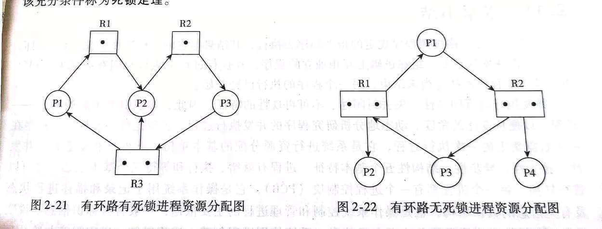

Figure 2-21 has three resource types, and each process's holdings and requests are shown clearly. Because there is a **cycle of holding and waiting for resources**, a group of processes waits forever: a **deadlock**.

But a cycle in the graph doesn't necessarily mean deadlock, because circular wait is a necessary but not sufficient condition. Figure 2-22 has a cycle but no deadlock. P1 and P3 each hold one R1 and one R2 and form a cycle while waiting for the other R2 and R1. But P2 and P4 each hold one R1 and one R2, their requests are satisfied, and they will release their resources in finite time. P1 or P3 can then get what it needs, the cycle breaks on its own, and the system isn't deadlocked.

#### Detection steps

Based on this, a **deadlock detection** program can use the following steps:

1. If the resource allocation graph has no cycle, the system is not deadlocked.
2. If it has a cycle and each resource type has only one resource, the system is deadlocked.
3. If it has a cycle and the resource types involved have multiple resources, the system isn't necessarily deadlocked. If you can find a process that is **neither blocked nor isolated**, it can release its resources in finite time, which removes its edges. Repeat this; if you can eventually **remove every edge**, there is no deadlock; otherwise there is. (Removing edges this way is similar to a **topological sort**.)

### Deadlock recovery

Once a deadlock is detected, the system has to recover from it. Four common methods:

1. **Kill all processes immediately and restart the OS**: simple, but all previous work is lost, which is very costly.
2. **Abort every process involved in the deadlock, then continue**: completely breaks the **circular wait**, but at a high price. Some processes may have been computing for a long time, their partial results are lost, and they have to recompute when rerun.
3. **Abort the deadlocked processes one at a time**, reclaiming their resources until the deadlock is resolved.
4. **Preempt resources**: take resources from one or more deadlocked processes and give them to other deadlocked processes until the deadlock is resolved.

## Quick reference

1. The OS manages hardware and software resources, and the kernel is the bridge between applications and hardware. The kernel is software; the CPU is hardware.
2. User mode has low privileges and kernel mode has high privileges. The switch happens through system calls, interrupts, or exceptions; entering kernel mode has overhead, so do it as little as possible.
3. A process is a running instance of a program. Threads share the process's heap and method area but have their own program counter and stacks.
4. Processes have five states: new, ready, running, waiting, and terminated. Common scheduling algorithms are FCFS, SJF, RR, MFQ, and priority scheduling.
5. The four necessary conditions for deadlock are mutual exclusion, hold and wait, no preemption, and circular wait. It can be handled by prevention, avoidance, detection, or recovery.

## References

Most of the links below are in Chinese.

- [Summary of common operating system interview questions (part 1) - JavaGuide](https://javaguide.cn/cs-basics/operating-system/operating-system-basic-questions-01.html) (source of this post)
- [Why operating systems separate user mode and kernel mode](https://blog.csdn.net/chen134225/article/details/81783980)
- [Understanding user mode and kernel mode from the ground up](https://juejin.cn/post/6923863670132850701)
- [What are zombie and orphan processes](https://blog.csdn.net/a745233700/article/details/120715371)
- [The banker's algorithm in one sentence and one picture](https://blog.csdn.net/qq_33414271/article/details/80245715)
- *Computer Operating Systems*, Tang Xiaodan, 4th edition
- *Computer Systems: A Programmer's Perspective*
- *重學作業系統* (Relearning Operating Systems)
