> 本文整理自 JavaGuide 的〈[作業系統常見面試題總結（上）](https://javaguide.cn/cs-basics/operating-system/operating-system-basic-questions-01.html)〉（Apache-2.0 授權），並改寫為繁體中文。文中圖片除另有註明外皆來自該文。原文部分內容參考《現代作業系統》第三版。

作業系統的觀念多又雜，但開發時處處用得到。這篇整理其中比較重要的部分：使用者態和核心態、系統呼叫、程序和執行緒、死鎖。這只是概覽，想深入的話還是建議讀教科書。

為什麼要學作業系統？很多作業系統的思想和經典演算法，都能在日常使用的工具和框架裡看到。例如 Redis 這類快取，跟 CPU 的快取記憶體（cache）概念很像：CPU 快取是為了解決 CPU 和記憶體速度不對等的問題；記憶體也可以看成外存的快取，程式執行時把外存的資料複製到記憶體，速度快得多；Redis 則是解決程式和關聯式資料庫之間速度不對等的問題。快取通常依局部性原理（2-8 原則）搭配淘汰演算法，讓常被存取的資料留在快取裡，這些淘汰演算法很多都和作業系統裡的類似。衡量快取的通用指標是命中率，也就是要存取的資料有多少能直接在快取中找到；命中率高，通常代表快取設計合理、系統也比較快。另外，作業系統也是面試（尤其是校園招募）很常考的主題。

## 作業系統基礎


### 什麼是作業系統

1. 作業系統（Operating System，OS）是管理電腦硬體與軟體資源的程式，是電腦的基石。
2. 作業系統本質上是一個執行在電腦上的軟體程式。例如電腦上所有應用程式，都是透過作業系統來使用記憶體、磁碟等硬體。
3. 作業系統遮蔽了硬體層的複雜性，就像硬體的負責人，統籌各種相關事項。
4. 核心（Kernel）是作業系統的核心部分，負責記憶體管理、硬體裝置管理、檔案系統管理以及應用程式管理。核心是連接應用程式和硬體的橋樑，決定系統的效能和穩定性。

很多人會把核心和 CPU（Central Processing Unit，中央處理器）搞混，可以從兩點區分：

1. 核心屬於作業系統層面，CPU 屬於硬體。
2. CPU 主要提供運算、處理指令的能力；核心主要負責系統管理（例如記憶體管理），遮蔽了對硬體的操作。

下圖是應用程式、核心、CPU 三者的關係：

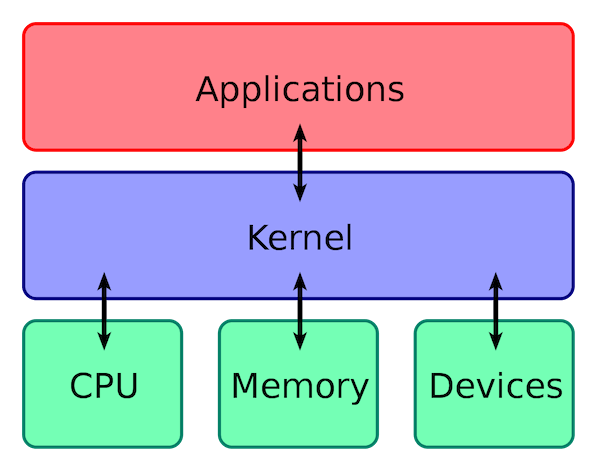

圖片來源：Bobbo，[Kernel_Layout.svg](https://commons.wikimedia.org/wiki/File:Kernel_Layout.svg)（Wikimedia Commons），採 [CC BY-SA 3.0](https://creativecommons.org/licenses/by-sa/3.0/) 授權。

### 作業系統的主要功能

從資源管理的角度，作業系統有 6 大功能：

1. **程序和執行緒管理**：程序的建立、撤銷、阻塞、喚醒，程序間的通訊等。
2. **儲存管理**：記憶體以及外存（磁碟等）的分配和管理。
3. **檔案管理**：檔案的讀、寫、建立及刪除等。
4. **裝置管理**：輸入輸出裝置和外部儲存裝置的請求、釋放與啟動等。
5. **網路管理**：管理網路的設定、連線、通訊和安全，提供高效可靠的網路服務。
6. **安全管理**：使用者身分驗證、存取控制、檔案加密等，防止非法使用者存取和操作系統資源。

### 常見的作業系統

- **Windows**：目前最流行的個人桌面作業系統，介面簡單易用，軟體生態很好，玩遊戲基本上都需要它。
- **Unix**：最早的多使用者、多工作業系統，後來的 Linux 在很多方面都參考了它。目前已逐漸退出主流。
- **Linux**：免費、開源的類 Unix 作業系統，有許多不同的發行版，但都使用 Linux 核心。
- **macOS**：蘋果自家的作業系統，開發體驗和 Linux 相當，介面、軟體生態和使用者體驗則比 Linux 更好。

> 嚴格來說，Linux 這個詞本身只代表 Linux 核心。在 GNU/Linux 系統中，Linux 就是核心，系統的其他部分主要由 GNU 專案提供的程式組成，單獨的 Linux 核心不是一個能正常運作的完整作業系統。因此很多人傾向用「GNU/Linux」來稱呼一般所說的 Linux。

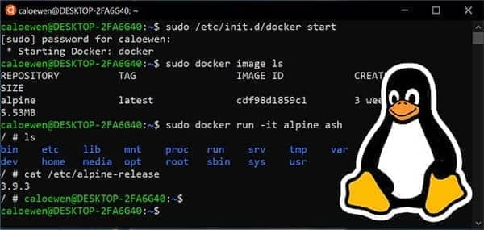

## 使用者態和核心態

### 什麼是使用者態和核心態

依照程序存取資源的特點，可以把程序在系統上的執行分成兩個等級：

- **使用者態（User Mode）**：可以直接讀取使用者程式的資料，權限較低。需要執行特殊權限的操作（例如讀寫磁碟、網路通訊）時，要向作業系統發起系統呼叫，進入核心態。
- **核心態（Kernel Mode）**：幾乎可以存取電腦的所有資源，包括系統記憶體空間、裝置、驅動程式等，權限非常高。作業系統收到程序的系統呼叫請求時，會從使用者態切換到核心態，執行對應的系統呼叫並把結果回傳給程序，最後再切換回使用者態。

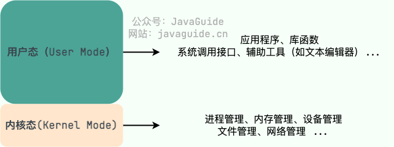

核心態的特權等級較高，能執行更底層、更敏感的操作。但進入核心態要付出較高的開銷（一連串的上下文切換和權限檢查），所以應該盡量減少進入核心態的次數，以提升效能和穩定性。

### 為什麼不能只有核心態

- CPU 指令中有些比較危險，例如記憶體分配、設定時鐘、I/O 處理。如果所有程式都能用，會對系統造成災難性的影響，所以要限制這些指令只能在核心態執行，這類指令稱為**特權指令**。
- 如果只有核心態，所有程式都必須共享記憶體、CPU、硬碟等資源，會造成資源競爭和衝突，影響效能；而且所有程式的權限都一樣，安全性也會降低。

所以同時有使用者態和核心態，主要是為了確保系統的安全性、穩定性和效能。

### 使用者態和核心態怎麼切換

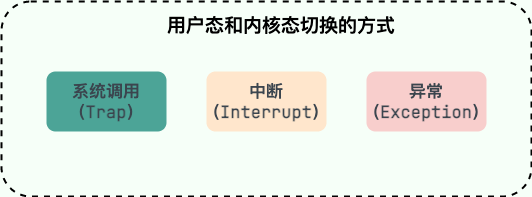

使用者態切換到核心態有 3 種方式：

1. **系統呼叫（Trap）**：使用者態程序**主動**要求切換到核心態，為了使用只有核心態才能做的事，例如讀取磁碟。系統呼叫的機制，核心是作業系統為使用者特別開放的一個中斷。
2. **中斷（Interrupt）**：外部裝置完成使用者請求的操作後，會向 CPU 發出中斷訊號。CPU 會暫停原本要執行的下一條指令，改去執行對應的中斷處理程式；如果先前執行的是使用者態程式，就會發生使用者態到核心態的切換。例如硬碟讀寫完成後，系統會切換到硬碟讀寫的中斷處理程式。
3. **異常（Exception）**：CPU 執行使用者態程式時發生了無法預期的異常，會切換到處理這個異常的核心程式，也就進入了核心態，例如缺頁異常（page fault）。

在處理上，中斷和異常類似，都是透過中斷向量表找到對應的處理程式。差別在於中斷來自處理器外部，不是由任何一條指令造成；異常則是執行當前指令的結果。

## 系統呼叫

### 什麼是系統呼叫

我們執行的程式基本上都在使用者態。要使用作業系統提供的核心態功能，就需要系統呼叫（system call）。也就是說，凡是跟系統態資源有關的操作（例如檔案管理、程序控制、記憶體管理），都必須透過系統呼叫向作業系統提出請求，由作業系統代為完成。

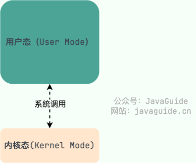

系統呼叫依功能大致分成幾類：

- **裝置管理**：裝置的請求、釋放與啟動等。
- **檔案管理**：檔案的讀、寫、建立及刪除等。
- **程序管理**：程序的建立、撤銷、阻塞、喚醒，程序間的通訊等。
- **記憶體管理**：記憶體的分配、回收，以及取得作業佔用的記憶體大小及位址等。

系統呼叫跟一般的函式庫呼叫很像，差別在系統呼叫由作業系統核心提供、在核心態執行；一般的函式庫呼叫由函式庫或使用者自己提供、在使用者態執行。

總結來說，系統呼叫是應用程式和作業系統互動的方式，應用程式透過它存取檔案、裝置、網路等底層資源。

### 系統呼叫的過程

1. 使用者態程式發起系統呼叫。系統呼叫涉及特權指令，使用者態程式權限不足，因此會中斷執行，也就是 Trap（Trap 是一種中斷）。
2. 發生中斷後，CPU 中斷目前的程式，跳到中斷處理程式，核心程式開始處理系統呼叫。
3. 核心處理完成後，主動觸發 Trap，再次發生中斷，切換回使用者態。

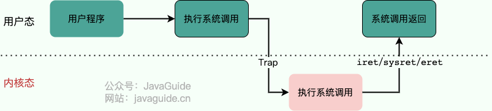

## 程序和執行緒

### 什麼是程序和執行緒

- **程序（Process）**：電腦中正在執行的一個程式實例。例如你開啟的通訊軟體就是一個程序。
- **執行緒（Thread）**：也叫輕量級程序。同一個程序裡可以有多個執行緒同時執行，並共享程序的資源，例如記憶體空間、檔案控制代碼、網路連線。例如通訊軟體裡會有一個執行緒專門拉取新訊息。

### 程序和執行緒的差別

從 JVM 的角度來看程序和執行緒的關係。下圖是 Java 的記憶體區域：

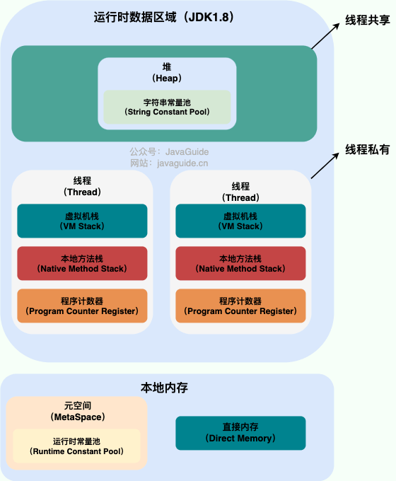

一個程序可以有多個執行緒。多個執行緒共享程序的**堆積（heap）**和**方法區**（JDK 1.8 之後是元空間）資源，但每個執行緒有自己的**程式計數器**、**虛擬機器堆疊**和**本地方法堆疊**。

總結：

- 執行緒是程序劃分出的更小執行單位，一個程序執行時可以產生多個執行緒。
- 最大的差別是各程序基本上是獨立的，執行緒則不一定，同一程序內的執行緒很可能互相影響。
- 執行緒的執行開銷小，但不利於資源的管理和保護；程序則相反。

### 有了程序為什麼還需要執行緒

- 程序切換的開銷很大，執行緒切換的成本較低。
- 執行緒更輕量，一個程序可以建立多個執行緒。
- 多個執行緒可以並行處理不同任務，更有效地利用多處理器和多核心電腦。程序同一時間只能做一件事，遇到 I/O 阻塞等情況就會掛起直到結果回傳。
- 同一程序內的執行緒共享記憶體和檔案，彼此通訊不需要呼叫核心。

### 為什麼要用多執行緒

整體來看：

- **從電腦底層來說**：執行緒是程式執行的最小單位，切換和排程的成本遠小於程序。而且多核心 CPU 讓多個執行緒可以同時執行，減少了執行緒上下文切換的開銷。
- **從網際網路的發展來說**：現在的系統動輒要求百萬甚至千萬等級的並行量，多執行緒並行程式設計正是高並行系統的基礎，善用多執行緒可以大幅提升系統的並行能力和效能。

再往底層看：

- **單核時代**：多執行緒主要是為了提高單一程序使用 CPU 和 I/O 的效率。假設只有一個 Java 程序，而且只有一個執行緒，這個執行緒被 I/O 阻塞時整個程序都會被阻塞，CPU 和 I/O 裝置同時只有一個在工作，可以粗略地說系統整體效率只有 50%。用多執行緒的話，一個執行緒被 I/O 阻塞，其他執行緒還能繼續使用 CPU。
- **多核時代**：多執行緒主要是為了提高程序利用多核心 CPU 的能力。例如計算一個複雜任務，只用一個執行緒的話，不管有幾個核心都只會用到一個。建立多個執行緒後，它們可以分配到多個核心上執行；在執行緒之間沒有資源競爭的情況下，執行時間約等於「單核執行時間 ÷ CPU 核心數」。

### 執行緒同步的方式

執行緒同步是讓兩個以上共享關鍵資源的執行緒並行執行時，避免資源使用衝突。常見方式有：

1. **互斥鎖（Mutex）**：只有擁有互斥物件的執行緒才能存取公共資源。互斥物件只有一個，所以公共資源不會被多個執行緒同時存取。Java 的 `synchronized` 關鍵字和各種 `Lock` 都是這種機制。
2. **讀寫鎖（Read-Write Lock）**：允許多個執行緒同時讀取共享資源，但同時只能有一個執行緒寫入。
3. **號誌（Semaphore）**：允許同一時刻多個執行緒存取同一資源，但會限制同時存取的最大執行緒數。
4. **屏障（Barrier）**：一種同步原語，讓多個執行緒在某個點等待，全部到齊後才一起繼續執行。Java 的 `CyclicBarrier` 就是這種機制。
5. **事件（Event）**：Wait/Notify，透過通知的方式保持多執行緒同步，也方便實現多執行緒的優先順序比較。

### PCB 是什麼

**PCB（Process Control Block，程序控制區塊）**是作業系統用來管理和追蹤程序的資料結構，每個程序都有一個獨立的 PCB，可以把它想成程序的大腦。

作業系統建立新程序時，會分配一個唯一的程序 ID，並建立對應的 PCB。程序執行時 PCB 的資訊會不斷變化，作業系統依照這些資訊管理和排程程序。PCB 主要包含：

- 程序的描述資訊：名稱、識別碼等。
- 程序的排程資訊：阻塞原因、程序狀態（就緒、執行、阻塞等）、優先順序等。
- 程序對資源的需求：CPU 時間、記憶體空間、I/O 裝置等。
- 程序開啟的檔案資訊：檔案描述符、檔案類型、開啟模式等。
- 處理器的狀態資訊（由各暫存器的內容組成）：通用暫存器、指令計數器、程式狀態字 PSW、使用者堆疊指標。
- 其他。

### 程序的狀態

程序一般分成 5 種狀態，跟執行緒很像：

- **建立（new）**：程序正在被建立，還沒到就緒狀態。
- **就緒（ready）**：已取得除了處理器以外的所有資源，一旦分到處理器時間片就能執行。
- **執行（running）**：正在處理器上執行（單核 CPU 任一時刻只有一個程序處於執行狀態）。
- **阻塞（waiting）**：又稱等待狀態，程序在等待某個事件（例如資源可用或 I/O 完成）而暫停。即使處理器空閒也不能執行。
- **結束（terminated）**：程序正在從系統中消失，可能是正常結束或因其他原因中斷。

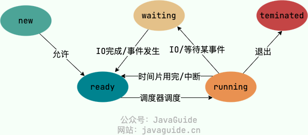

### 程序間的通訊方式

1. **管道 / 匿名管道（Pipes）**：用於有親緣關係的父子程序或兄弟程序之間的通訊。
2. **具名管道（Named Pipes）**：匿名管道沒有名字，只能用在有親緣關係的程序之間；具名管道就是為了克服這個限制。它嚴格遵循**先進先出（First In First Out）**，以磁碟檔案的形式存在，可以讓本機任意兩個程序通訊。
3. **訊號（Signal）**：比較複雜的通訊方式，用來通知接收程序某個事件已經發生。
4. **訊息佇列（Message Queuing）**：訊息的鏈結串列，有特定格式，存放在記憶體中，由訊息佇列識別碼標識。管道和訊息佇列的資料都是先進先出。不同的是，匿名管道只存在於記憶體、具名管道存在於磁碟或檔案系統，而訊息佇列存放在核心中，只有核心重啟（作業系統重啟）或明確刪除時才會被真正刪除。訊息佇列可以隨機查詢，不一定要依先進先出的順序讀取，也可以依訊息類型讀取，比 FIFO 更有彈性。**訊息佇列克服了訊號承載資訊少、管道只能傳無格式位元組流以及緩衝區大小受限等缺點。**
5. **號誌（Semaphores）**：一個計數器，用於多個程序存取共享資料，目的是程序間同步，主要用來解決同步問題並避免競爭條件。
6. **共享記憶體（Shared memory）**：讓多個程序存取同一塊記憶體空間，一個程序對資料的更新其他程序能即時看到。需要搭配互斥鎖、號誌等同步機制。可以說是最有用的程序間通訊方式。
7. **通訊端（Sockets）**：主要用於用戶端和伺服器之間透過網路通訊。Socket 是支援 TCP/IP 網路通訊的基本操作單元，可以看成不同主機上的程序進行雙向通訊的端點。

### 程序排程演算法

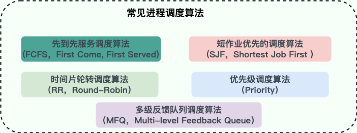

為了決定先執行哪個程序、後執行哪個程序，以達到最大的 CPU 使用率，電腦科學家定義了幾種演算法：

- **先到先服務（FCFS，First Come, First Served）**：從就緒佇列選最先進入的程序分配資源，讓它一直執行到完成，或發生某事件被阻塞而放棄 CPU，才重新排程。
- **短作業優先（SJF，Shortest Job First）**：從就緒佇列選估計執行時間最短的程序分配資源，同樣執行到完成或被阻塞才重新排程。
- **時間片輪轉（RR，Round-Robin）**：最古老、最簡單、最公平也最廣泛使用的演算法。每個程序被分配一段允許執行的時間，稱為時間片。
- **多級回饋佇列（MFQ，Multi-level Feedback Queue）**：前面幾種演算法都有侷限，例如**短作業優先只照顧短程序而忽略長程序**。多級回饋佇列既能讓高優先順序的作業得到回應，又能讓短作業迅速完成，是目前**公認比較好的排程演算法**，UNIX 採用的就是這種。
- **優先順序排程（Priority）**：為每個程序分配優先順序，先執行優先順序最高的，依此類推；相同優先順序的程序以 FCFS 方式執行。優先順序可以依記憶體需求、時間需求或其他資源需求來決定。

### 殭屍程序和孤兒程序

在 Unix/Linux 中，子程序通常由 `fork()` 系統呼叫建立，它是原程序的副本。父子程序的執行互相獨立，各自擁有 PCB，即使父程序結束，子程序仍可繼續執行。

程序呼叫 `exit()` 結束時，核心會釋放它的所有資源（開啟的檔案、佔用的記憶體等），但它的 PCB 仍留在系統中，要等父程序呼叫 `wait()` 或 `waitpid()` 才會釋放，好讓父程序取得子程序的狀態資訊。

- **殭屍程序（zombie）**：子程序已經終止，但父程序仍在執行，且沒有呼叫 `wait()` 或 `waitpid()` 取得子程序狀態並回收資源，導致子程序的 PCB 一直留在系統中。要避免殭屍程序，父程序需要及時呼叫 `wait()` 或 `waitpid()` 回收子程序。
- **孤兒程序（orphan）**：父程序已經終止或不存在，但子程序仍在執行。通常是父程序意外終止造成的。為了避免孤兒程序佔用資源，作業系統會把它的父程序設為 init 程序（PID 1），由 init 回收它的資源。

### 怎麼檢查有沒有殭屍程序

Linux 可以用 `top` 查看，`zombie` 的值就是殭屍程序的數量，0 代表沒有。

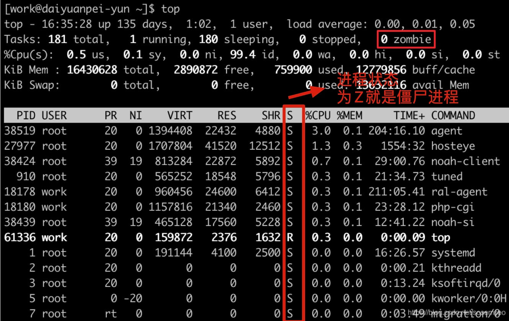

下面的指令可以找出殭屍程序以及它的父程序：

```bash
ps -A -ostat,ppid,pid,cmd | grep -e '^[Zz]'
```

## 死鎖

### 什麼是死鎖

死鎖（Deadlock）是指多個程序或執行緒同時被阻塞，其中一個或全部都在等待某個資源被釋放。由於它們被無限期地阻塞，程式不可能正常終止。

### 死鎖的例子

假設有程序 A、B 和資源 X、Y：

| 程序 | 佔用資源 | 需求資源 |
| --- | --- | --- |
| A | X | Y |
| B | Y | X |

A 佔用 X 並請求 Y，B 佔用 Y 並請求 X。兩個程序都在等對方釋放資源，無法繼續執行，陷入死鎖。

### 死鎖的四個必要條件

1. **互斥**：資源處於非共享模式，一次只有一個程序能使用。其他程序申請時必須等到它被釋放。
2. **佔有並等待**：一個程序至少佔有一個資源，同時在等待另一個被其他程序佔有的資源。
3. **非搶佔**：資源不能被搶佔，只能在持有它的程序完成任務後釋放。
4. **循環等待**：有一組等待中的程序 `{P0, P1, ..., Pn}`，`P0` 等待的資源被 `P1` 佔有，`P1` 等待的資源被 `P2` 佔有，……，`Pn` 等待的資源被 `P0` 佔有。

**注意**：這四個是**必要條件**，也就是只要發生死鎖，這四個條件一定都成立；只要其中一個不成立，就不會發生死鎖。

> 必要條件的定義：如果沒有 A 就一定沒有 B，也就是有 B 就一定有 A，那 A 就是 B 的必要條件。從邏輯上看，B 能推出 A，A 是 B 的必要條件，等價於 B 是 A 的充分條件。

### 模擬死鎖的程式

下面用 Java 模擬圖中的執行緒死鎖：

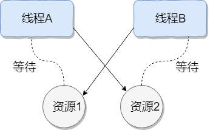

```java
public class DeadLockDemo {
    private static Object resource1 = new Object();//資源 1
    private static Object resource2 = new Object();//資源 2

    public static void main(String[] args) {
        new Thread(() -> {
            synchronized (resource1) {
                System.out.println(Thread.currentThread() + "get resource1");
                try {
                    Thread.sleep(1000);
                } catch (InterruptedException e) {
                    e.printStackTrace();
                }
                System.out.println(Thread.currentThread() + "waiting get resource2");
                synchronized (resource2) {
                    System.out.println(Thread.currentThread() + "get resource2");
                }
            }
        }, "執行緒 1").start();

        new Thread(() -> {
            synchronized (resource2) {
                System.out.println(Thread.currentThread() + "get resource2");
                try {
                    Thread.sleep(1000);
                } catch (InterruptedException e) {
                    e.printStackTrace();
                }
                System.out.println(Thread.currentThread() + "waiting get resource1");
                synchronized (resource1) {
                    System.out.println(Thread.currentThread() + "get resource1");
                }
            }
        }, "執行緒 2").start();
    }
}
```

輸出：

```
Thread[執行緒 1,5,main]get resource1
Thread[執行緒 2,5,main]get resource2
Thread[執行緒 1,5,main]waiting get resource2
Thread[執行緒 2,5,main]waiting get resource1
```

執行緒 1 透過 `synchronized (resource1)` 取得 `resource1` 的監視器鎖，再用 `Thread.sleep(1000)` 休眠 1 秒，讓執行緒 2 有機會執行並取得 `resource2` 的監視器鎖。兩個執行緒休眠結束後都去請求對方的資源，於是互相等待，產生死鎖。

### 處理死鎖的四種方法

一般分成**預防、避免、檢測和解除**四種：

- **預防**：用某種策略**限制並行程序對資源的請求**，讓死鎖的必要條件在任何時候都不成立。
- **避免**：系統在分配資源時，依資源使用情況**提前預測**，避免死鎖發生。
- **檢測**：系統設有**專門的機制**，在死鎖發生時偵測到它，並精確找出相關的程序和資源。
- **解除**：搭配檢測使用，**讓程序從死鎖狀態中脫離**。

### 死鎖的預防

只要破壞四個必要條件中的任何一個，就能預防死鎖。

- 破壞**互斥**：讓資源可以同時存取。這方法簡單，磁碟就可以這樣管理，但很多資源**本來就不能同時存取**，所以大多數場合行不通。
- 破壞**非搶佔**：採用**剝奪式排程演算法**。但目前一般只適用於**主記憶體**和**處理器**資源的分配，不適用所有資源，而且會**降低資源使用率**。

所以比較實用的預防方法，是破壞第二個和第四個條件：

**1. 靜態分配策略**：破壞「佔有並等待」。程序必須在執行前申請到所有需要的資源，全部滿足後才開始執行。程序要嘛佔有全部資源再執行，要嘛不佔有任何資源，不會出現佔有一部分、等待另一部分的情況。

這個策略邏輯簡單、容易實作，但會**嚴重降低資源使用率**。有些資源在執行後期才用到，甚至只在特殊情況下才用，程序卻一開始就佔著，導致**其他需要這些資源的程序只能等待**。

**2. 層次分配策略**：破壞「循環等待」。所有資源被分成多個層次，程序取得某一層的資源後，只能再申請更高層的資源；要釋放某層資源時，必須先釋放已佔有的更高層資源。這樣不可能形成循環等待鏈，因為那代表有程序已申請了高層資源，又回頭申請低層資源，違反了規則。

### 死鎖的避免

破壞必要條件可以預防死鎖，但會造成程序執行效率低、資源使用率低。死鎖的避免則相反：允許四個必要條件**同時存在**，只要掌握每個程序動態申請資源的情況，做出合理的分配決定，仍然可以避免死鎖，因為四個條件只是必要條件，不是充分條件。

系統狀態分成**安全狀態**和**不安全狀態**。每次分配資源前先測試：如果分配後會產生死鎖就拒絕，否則才分配。

> 如果作業系統能保證所有程序在有限時間內取得需要的全部資源，就稱系統處於安全狀態，否則是不安全的。系統處於安全狀態就不會死鎖；處於不安全狀態則可能死鎖。

最具代表性的避免死鎖演算法是 Dijkstra 的**銀行家演算法**。一句話說明：程序申請資源時，先**試探性**地分配給它，再用**安全性演算法**判斷分配後系統是否處於安全狀態。不安全就作廢這次試探，讓程序繼續等待；安全才**真的分配**。詳細說明可以看〈[一句話+一張圖說清楚——銀行家演算法](https://blog.csdn.net/qq_33414271/article/details/80245715)〉，作業系統教科書裡的說明也很清楚。

銀行家演算法改善了資源使用率低的問題，但它要不斷檢查每個程序對各類資源的佔用和申請情況，並做**安全性檢查**，需要花比較多時間。

### 死鎖的檢測

預防和避免都會限制資源分配，不利於程序**充分共享**資源。另一條路是**死鎖檢測和解除**：資源分配不加任何限制，也不採取避免措施，而是**定時執行死鎖檢測程式**，發現死鎖再處理。

這有點像樂觀鎖和悲觀鎖：檢測和解除像**樂觀鎖**，分配時不管會不會死鎖，真的發生了再解決；預防和避免則像**悲觀鎖**，總覺得會死鎖，分配時就很謹慎。

#### 程序-資源分配圖

每一時刻的系統狀態都可以用**程序-資源分配圖**表示。它是描述程序和資源申請、分配關係的有向圖，可以用來**檢測系統是否死鎖**。

每個資源類用一個方框表示，方框中的黑點代表該類中的各個資源；每個程序用一個圓圈表示；用**有向邊**表示程序申請資源和資源被分配的情況。

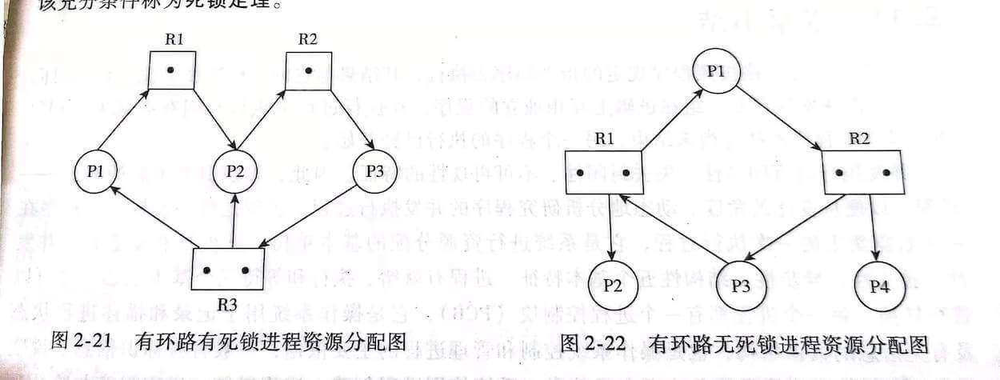

圖 2-21 有三個資源類，每個程序的資源佔有和申請情況都清楚標示在圖中。因為存在**佔有和等待資源的環路**，一組程序永遠在等待資源，發生了**死鎖**。

但圖中有環路不一定代表死鎖，因為循環等待只是必要條件，不是充分條件。圖 2-22 就是有環路但沒有死鎖的例子：P1 和 P3 各佔用一個 R1 和一個 R2，又因為等待另一個 R2 和 R1 而形成環路；但 P2 和 P4 各佔有一個 R1 和 R2，它們的申請已經滿足，會在有限時間內歸還資源，P1 或 P3 就能取得需要的資源，環路自動解除，系統沒有死鎖。

#### 死鎖檢測步驟

依照上面的原理，可以用下列步驟寫一個**死鎖檢測**程式：

1. 程序-資源分配圖中沒有環路：系統沒有死鎖。
2. 有環路，且每個資源類只有一個資源：系統已經死鎖。
3. 有環路，且涉及的資源類有多個資源：不一定死鎖。如果能在圖中找出一個**既不阻塞又非獨立的程序**，它能在有限時間內歸還資源，也就是把它的邊消除掉。重複這個過程，如果最後能**消除所有的邊**，就不會死鎖，否則就會死鎖。（消除邊的過程類似**拓撲排序**。）

### 死鎖的解除

偵測到死鎖後，要讓系統從死鎖狀態恢復，常用的方法有四種：

1. **立即結束所有程序，重新啟動作業系統**：簡單，但之前的工作全部作廢，損失很大。
2. **撤銷所有涉及死鎖的程序，解除後繼續執行**：能徹底打破**循環等待**，但代價很大。有些程序可能已經計算很久，被撤銷後部分結果也會消失，重新執行時要再算一次。
3. **逐個撤銷涉及死鎖的程序**，回收資源，直到死鎖解除。
4. **搶佔資源**：從一個或幾個涉及死鎖的程序搶佔資源，再分配給其他涉及死鎖的程序，直到死鎖解除。

## 重點速記

1. 作業系統管理硬體與軟體資源，核心是連接應用程式和硬體的橋樑；核心屬於軟體，CPU 屬於硬體。
2. 使用者態權限低、核心態權限高；切換方式有系統呼叫、中斷、異常三種，進入核心態有開銷，應盡量減少。
3. 程序是執行中的程式實例，執行緒共享程序的堆積和方法區，但有各自的程式計數器和堆疊。
4. 程序有新建、就緒、執行、阻塞、結束五種狀態；常見排程演算法有 FCFS、SJF、RR、MFQ 和優先順序排程。
5. 死鎖的四個必要條件：互斥、佔有並等待、非搶佔、循環等待；處理方法有預防、避免、檢測、解除。

## 參考資料

- [作業系統常見面試題總結（上）- JavaGuide](https://javaguide.cn/cs-basics/operating-system/operating-system-basic-questions-01.html)（本文來源）
- [作業系統為什麼要分使用者態和核心態](https://blog.csdn.net/chen134225/article/details/81783980)
- [從根上理解使用者態與核心態](https://juejin.cn/post/6923863670132850701)
- [什麼是殭屍程序與孤兒程序](https://blog.csdn.net/a745233700/article/details/120715371)
- [一句話+一張圖說清楚——銀行家演算法](https://blog.csdn.net/qq_33414271/article/details/80245715)
- 《計算機作業系統》湯小丹，第四版
- 《深入理解計算機系統》
- 《重學作業系統》
